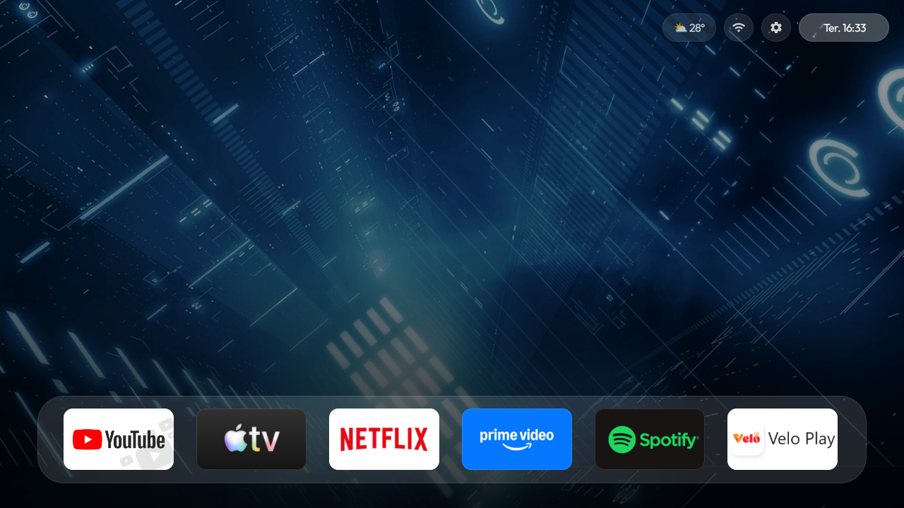
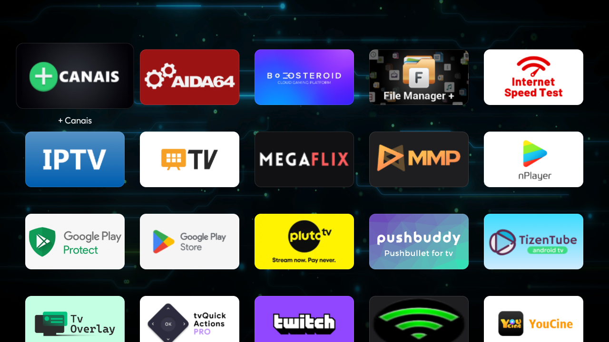
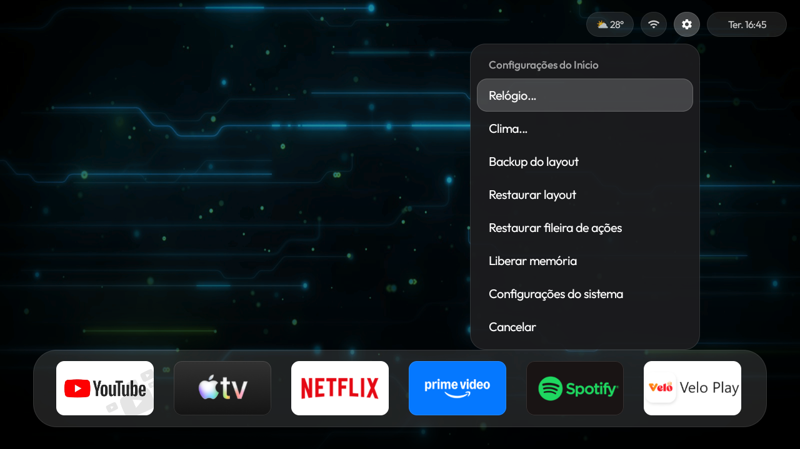
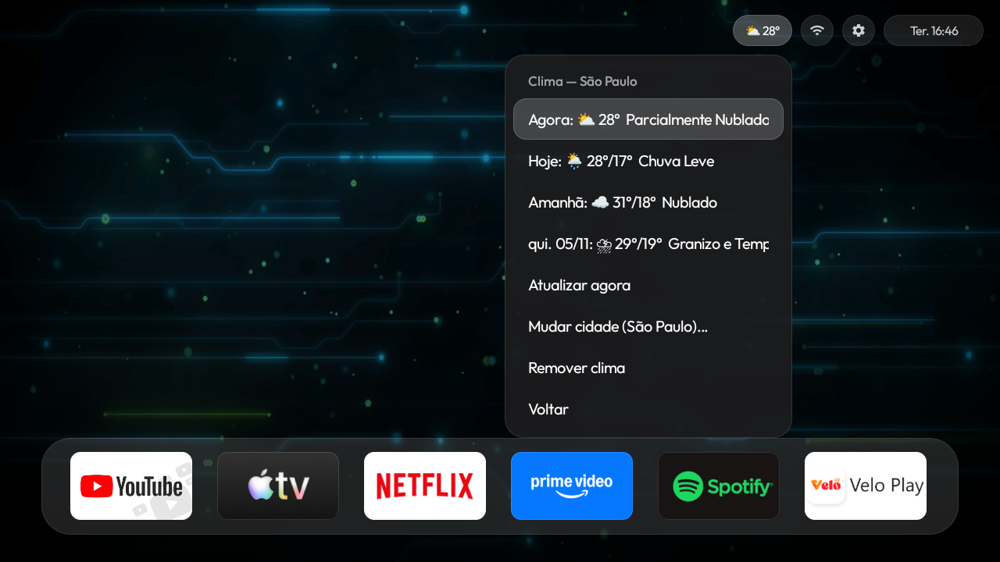

[🇺🇸 English](README.md) | [🇧🇷 Português](README_pt.md)

# 📺 Apple TV Launcher (Smart TV)



A custom, modern launcher for Smart TVs running **Android 9+** (optimized for Android 14). Inspired by the clean interface of Apple TV.


### ⬇️ [Download Latest APK (v1.0.0)](https://github.com/joshwps/apple-tv-launcher-smarttv/releases/latest)

> **Credits:** This project was originally based on the code by [Kulwant Nagi](https://github.com/kulwantnagi) and has been deeply modified, optimized, and adapted by [Joshwps](https://github.com/joshwps).

## 📸 Screenshots

### 🏠 Home Screen


### 📱 App Grid


### ⚙️ Settings Menu


### ☀️ Weather Menu


---

## ✨ Features and User Guide

The launcher is designed to be fully customizable using the TV remote control. Below are all the actions you can perform:

### 🎮 Navigation and Control
- **Navigate:** Use the D-pad on your remote to move focus between apps in the Dock and the Grid.
- **Open App:** Press the **OK** button quickly to open the selected app.
- **Options Menu (Long Press):** With focus on an app, **press and hold the OK button** to open the customization menu. There you can:
  - Rename the app.
  - Change the icon (by choosing an image from the TV storage).
  - Restore the original factory name and icon.

### 🎨 Visual Customization
- **Wallpaper:** Change the background by accessing the launcher settings.
- **Fonts and UI:** Optimized interface with sharper, bolder fonts and shadows for better readability from a distance.

### 🌤️ Weather and Clock
- **Weather Widget:** Set your city and see real-time temperature and weather conditions (Open-Meteo API).
- **Clock Overlay:** Enable or disable the floating clock that appears over opened apps.
- **Overlay Position:** Choose which corner of the screen the clock will appear when you open YouTube, Netflix, etc.
- **Clock Format:** Switch between 12h or 24h format, and enable/disable seconds display.


### 📱 Phone Remote
The launcher features a built-in web server that turns your phone into a complete remote control.
- **How to access:** With the TV and phone on the same Wi-Fi network, open your phone's browser and type the address shown in the launcher settings menu (e.g., `http://192.168.1.167:8080`).
- **What you can do:**
  - Trackpad (swipe to navigate, tap to select).
  - Virtual keyboard (type on the TV in real-time).
  - Volume and mute control.
  - Launch apps directly.

### 💾 System and Backup
- **Layout Backup:** Save **everything** into a secure `.zip` file.
- **Restore:** Restore the complete layout with one click.
- **Default Launcher:** Set the app as the system home screen.

## 🛠️ How to Build (Without Android Studio)

You only need **Java (JDK 17)** and the **Android SDK** configured on your Linux machine.

```bash
git clone https://github.com/joshwps/apple-tv-launcher-smarttv.git
cd apple-tv-launcher-smarttv/launcher
./gradlew assembleDebug
```

The APK will be generated at: `launcher/app/build/outputs/apk/debug/app-debug.apk`

## 📲 How to Install on TV

With the TV connected via ADB, run:
```bash
adb install -r launcher/app/build/outputs/apk/debug/app-debug.apk
```

## 📄 License
This project is licensed under the MIT License. See the [LICENSE](LICENSE) file for details.
