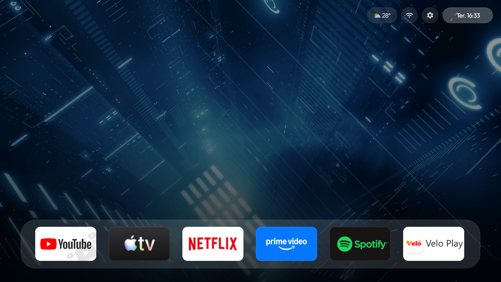
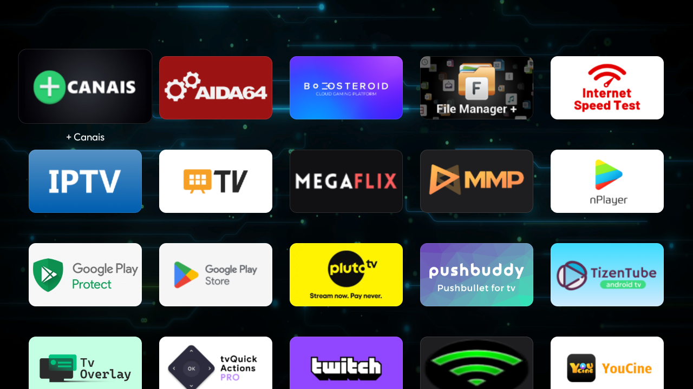
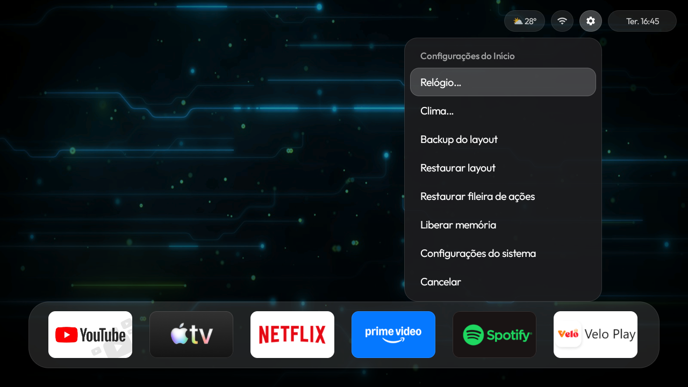
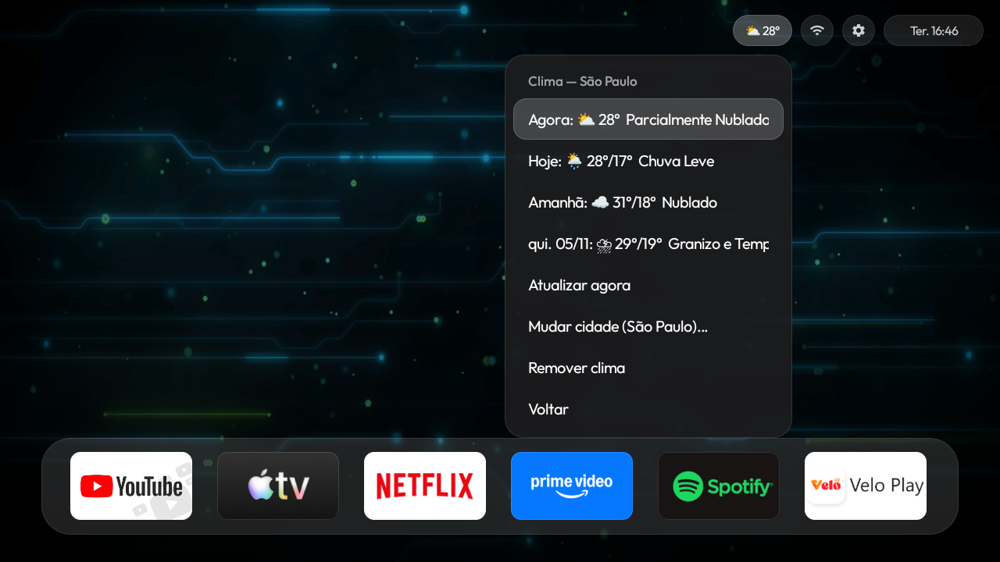

[🇺🇸 English](README.md) | [🇧🇷 Português](README_pt.md)

# 📺 Apple TV Launcher (Smart TV)



Um launcher customizado e moderno para Smart TVs com **Android TV** ou **Google TV**. Inspirado na interface limpa da Apple TV. Desenvolvido para funcionar em diversas marcas de TVs. Em caso de dúvida, basta copiar os detalhes do projeto e consultar um chat de IA para verificar a compatibilidade do seu modelo.


### ⬇️ [Baixar o APK (v1.0.0)](https://github.com/joshwps/apple-tv-launcher-smarttv/releases/latest)

> **Créditos:** Este projeto foi originalmente baseado no código de [Kulwant Nagi](https://github.com/kulwantnagi) e foi profundamente modificado, otimizado e adaptado por [Joshwps](https://github.com/joshwps).

## 📸 Screenshots

### 🏠 Tela Inicial


### 📱 Grade de Aplicativos


### ⚙️ Menu de Configurações


### ☀️ Menu do Clima


---

## ✨ Funcionalidades e Guia de Uso

O launcher foi desenhado para ser totalmente personalizável usando o controle remoto da TV. Abaixo estão todas as ações que você pode realizar:

### 🎮 Navegação e Controle
- **Navegar:** Use as setas do controle para mover o foco entre a Dock e a Grade.
- **Abrir App:** Aperte o botão **OK** rapidamente para abrir o aplicativo selecionado.
- **Menu de Opções (Clique Longo):** Com o foco sobre um aplicativo, **pressione e segure o botão OK** para abrir o menu de personalização. Lá você pode:
  - Renomear o aplicativo.
  - Alterar o ícone (escolhendo uma imagem do armazenamento da TV).
  - Restaurar o nome e o ícone original de fábrica.

### 🎨 Personalização Visual
- **Papel de Parede (Wallpaper):** Altere o plano de fundo acessando as configurações do launcher.
- **Fontes e Interface:** Interface otimizada com fontes mais nítidas, grossas e com sombras para melhor leitura a distância.

### 🌤️ Clima e Relógio
- **Widget de Clima:** Configure sua cidade e veja a temperatura em tempo real e a condição do tempo (Open-Meteo API).
- **Overlay de Relógio:** Ative ou desative o relógio flutuante que aparece sobre os aplicativos abertos.
- **Posição do Overlay:** Escolha em qual canto da tela o relógio vai aparecer quando você abrir o YouTube, Netflix, etc.
- **Formato do Relógio:** Altere entre formato 12h ou 24h, e ative/desative a exibição dos segundos.


### 📱 Controle Remoto pelo Celular (Phone Remote)
O launcher possui um servidor web embutido que transforma o seu celular em um controle remoto completo.
- **Como acessar:** Com a TV e o celular na mesma rede Wi-Fi, abra o navegador do celular e digite o endereço que aparece no menu de configurações do launcher (ex: `http://192.168.1.167:8080`).
- **O que você pode fazer:**
  - D-Pad Virtual (setas direcionais e botão OK).
  - Teclado virtual (digitar textos na TV em tempo real).
  - Controle de volume e mudo.
  - Abrir aplicativos diretamente.

### 💾 Sistema e Backup
- **Backup do Layout:** Salve **tudo** (posições, ícones personalizados, nomes, wallpaper, clima) em um arquivo `.zip` seguro.
- **Restauração:** Restaure o layout completo em um clique.
- **Launcher Padrão:** Defina o app como a tela inicial do sistema.

## 🛠️ Como Compilar (Sem Android Studio)

Você só precisa do **Java (JDK 17)** e do **Android SDK** configurados no seu Linux.

```bash
git clone https://github.com/joshwps/apple-tv-launcher-smarttv.git
cd apple-tv-launcher-smarttv/launcher
./gradlew assembleDebug
```

O APK será gerado em: `launcher/app/build/outputs/apk/debug/app-debug.apk`

## 📲 Como Instalar na TV

Com a TV conectada via ADB, rode:
```bash
adb install -r launcher/app/build/outputs/apk/debug/app-debug.apk
```

## 📄 Licença
Este projeto está licenciado sob a Licença MIT. Veja o arquivo [LICENSE](LICENSE) para mais detalhes.

## 🔧 Problemas Comuns (Troubleshooting)

### O launcher não abre ao apertar o botão Home
1. Vá em **Configurações > Aplicativos > Apps Padrão > App Inicial** e selecione o **Apple TV Launcher**.
2. Ou rode via ADB: `adb shell cmd package set-home-activity com.kulwant.atvhome/.HomeActivity`

### O Controle Remoto (Phone Remote) não carrega no celular
1. Verifique se a TV e o celular estão na **mesma rede Wi-Fi**.
2. A TV precisa estar acordada (não pode estar em modo de repouso).
3. Veja o IP da TV nas configurações do launcher e digite no navegador do celular (ex: `http://192.168.1.167:8080`).

### O ADB diz "Connection refused" ou "Device offline"
1. Vá em **Configurações > Sistema > Opções do Desenvolvedor** na TV.
2. Desligue e ligue a **Depuração USB** novamente.
3. Rode `adb connect <IP_DA_TV>:5555` de novo.

### O clima não está carregando
1. Verifique se a TV está conectada à internet.
2. Vá nas configurações de Clima do launcher e digite sua cidade novamente (ex: "São Paulo").
